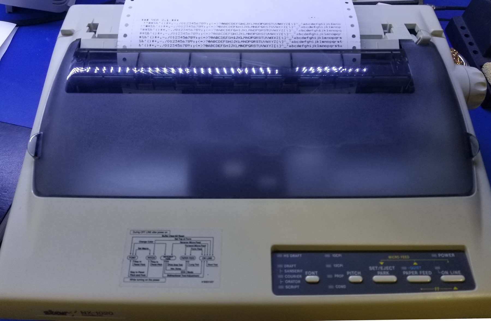
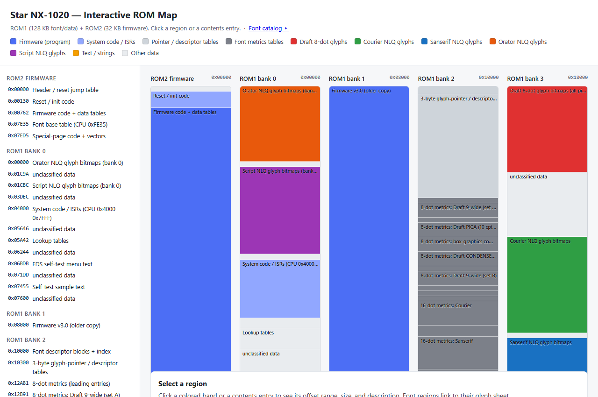
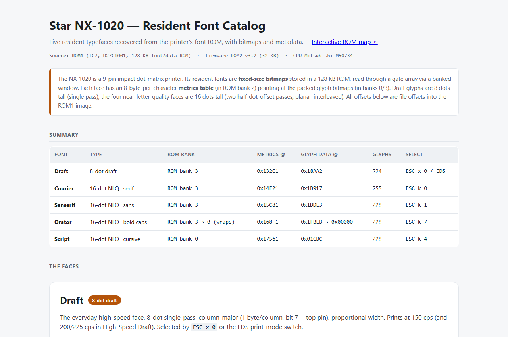
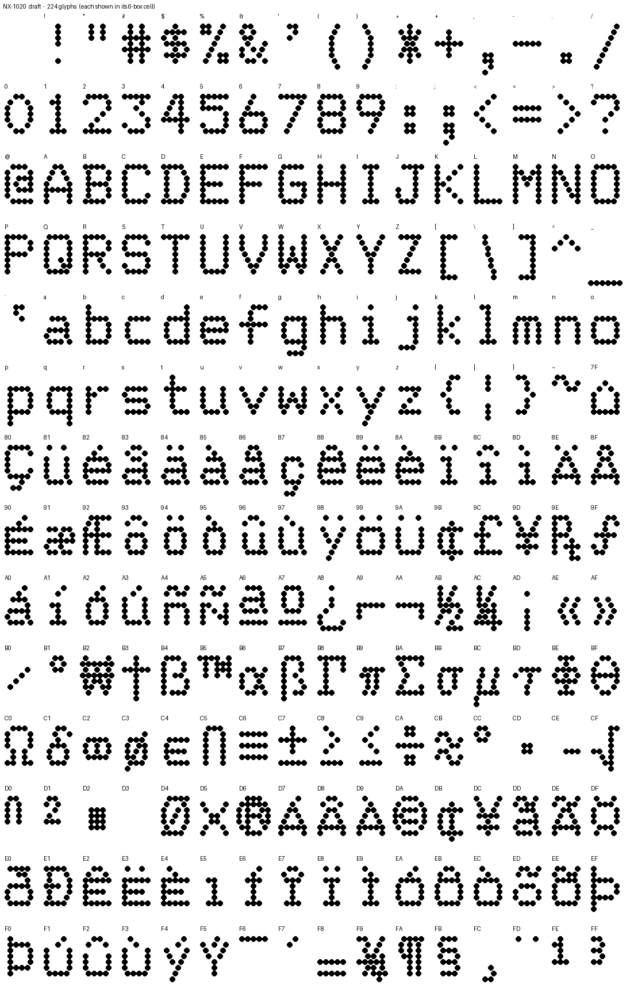
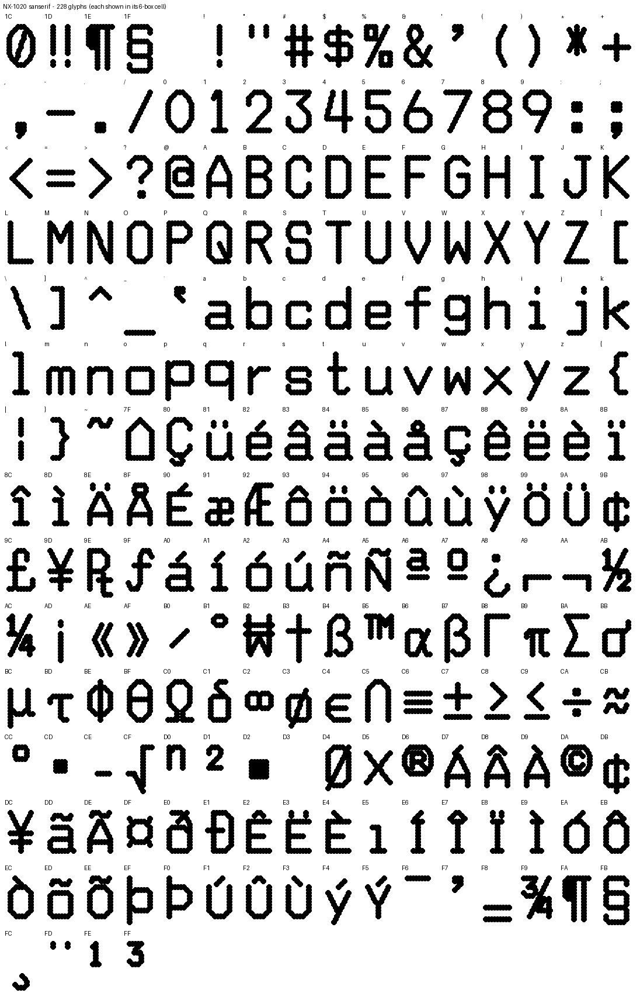
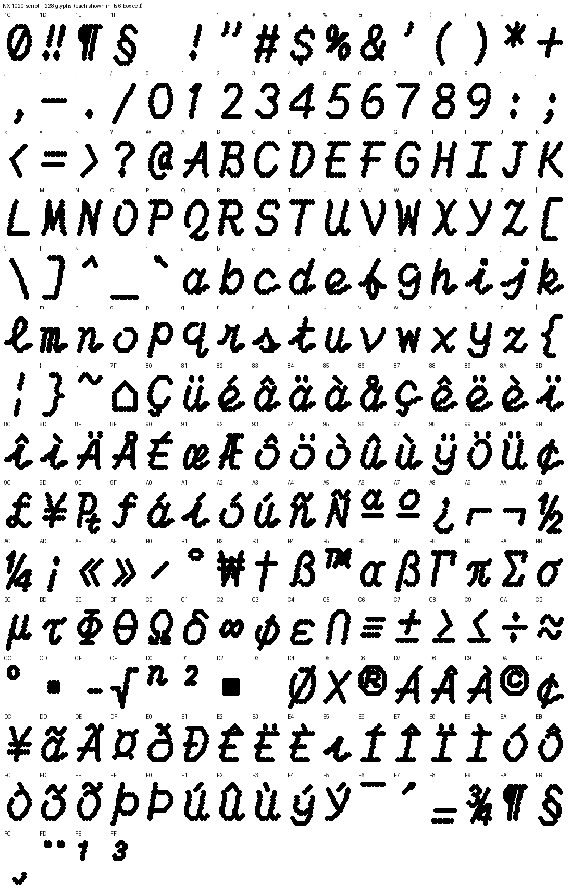

# Star NX-1020 Reverse Engineering

<p align="center">
  
</p>

<p align="center">
The Star Micronics NX-1020 is a 9-pin dot-matrix printer from about 1990. The goal of this
project was to reverse engineer it far enough to extract an <b>exact copy of the resident
fonts</b> stored in its ROMs. Getting there ended up producing a lot more: a full theory of
operation for the printer, a mapped and labeled firmware disassembly, and an improved
740-family disassembler.
</p>

## Start here

<table>
<tr>
<td align="center" width="50%">
<a href="https://keithgh1.github.io/star-nx1020-re/deliverables/ROM_MAP.html"></a>
<br><b><a href="https://keithgh1.github.io/star-nx1020-re/deliverables/ROM_MAP.html">Interactive ROM map</a></b><br>
Both ROMs as clickable, color-coded columns - firmware, system code, metrics and pointer
tables, and each font's glyph bank - with a contents sidebar and per-region detail panel.
<i>Opens right in the browser.</i>
</td>
<td align="center" width="50%">
<a href="deliverables/FONT_CATALOG.pdf"></a>
<br><b><a href="deliverables/FONT_CATALOG.pdf">Resident font catalog (PDF)</a></b><br>
Every typeface with a full glyph sheet and its metadata - the five faces plus the draft
pitch variants and extended character sets. <i>Views directly on GitHub; also as a
<a href="https://keithgh1.github.io/star-nx1020-re/deliverables/FONT_CATALOG.html">browsable HTML page</a>.</i>
</td>
</tr>
</table>

## Results

- **Every resident typeface extracted exactly**: Draft plus the four 16-dot NLQ faces
  (Courier, Sanserif, Orator, Script), the draft pitch faces, and the accent/box-graphics
  sets - all rendered as full glyph sheets. Notable findings: NLQ glyphs are stored
  planar-interleaved for the head's two-pass half-dot printing, italics are a programmatic
  slant (not stored), and High-Speed Draft turns out to have its own stored faces - drawn
  narrower than Draft's (9-wide pica, 7-wide elite) so each glyph needs fewer head fires,
  which is half of where its speed comes from.
- **The font ROM mapped at ~88% coverage** - glyphs, metrics, descriptor/pointer tables, and
  firmware/system regions all accounted for.
- **The firmware understood end to end** - power-on through command parsing, line building,
  glyph fetch, head fire, carriage, and paper feed, written up in
  [docs/](docs/) (start with the [theory of operation](docs/THEORY_OF_OPERATION.md)).

Three examples of the extracted faces are below. The full set of **11 glyph sheets** lives in
[deliverables/](deliverables/): all **5 typefaces** (**1,163 glyphs** total) plus the draft
pitch variants and the accent and box-graphics extended sets.

| Draft (example) | Sanserif NLQ (example) | Script NLQ (example) |
|---|---|---|
|  |  |  |

## Undocumented features

Star's manuals document the `ESC EM` command with exactly four subcommands (`0`, `4`, `R`,
`T n` - all automatic-sheet-feeder control). The firmware's dispatcher quietly accepts three
more, found in neither the users manual nor the technical manual:

| Sequence | What it does |
|---|---|
| `ESC EM C n` | Selects the print color - a hidden alias of `ESC r n` |
| `ESC EM F n` | Selects a resident font directly by its internal descriptor index, bypassing the documented `ESC k` typeface list |
| `ESC EM S n` | Double-height / size control, routing into the `ESC w` machinery with an extra mode flag |

Handler addresses and decoded semantics are in [docs/ESC_COMMANDS.md](docs/ESC_COMMANDS.md).

And one find outside the printer itself: the M50734 CPU datasheet contains a period
misprint - its interrupt vector table lists INT1 for two different vectors. The schematic,
the firmware's behavior, and the datasheet's own register diagrams pin down the real
assignment (see [docs/PORT_MAP.md](docs/PORT_MAP.md)).

## How it was done

1. **ROM dumps and hardware survey.** Two ROMs were dumped from the board: a 32 KB firmware
   ROM and a 128 KB font/data ROM. Tracing the schematic established the architecture: a
   Mitsubishi M50734 CPU (740 family, 6502-derived), with the font ROM *outside* the CPU's
   address space - it hangs off a separate 17-bit bus behind a custom gate array.

2. **Direct ROM analysis.** The first pass worked on the ROM images alone: separating code
   from data using texture maps and byte-statistics, then autocorrelation to detect the
   repeating cell strides of glyph data. This static approach had real success - it located
   the font metrics tables and cracked the 8-dot draft format (column-major, 1 byte per
   column, per-character widths derived from pointer deltas).

3. **Firmware disassembly.** The remaining formats couldn't be guessed from the data alone;
   the firmware had to be read to see how *it* fetched glyphs. The existing
   [m740dasm](https://github.com/mnaberez/m740dasm) disassembler provided a solid 740-family
   foundation, but the analysis this job required went beyond its scope - so it was extended
   with control files, value-tracking analysis, cross-references, and machine-readable
   reports, becoming **[m740recon](https://github.com/keithgh1/m740recon)**. With it, the
   firmware was fully mapped: 635 routines, the interrupt architecture (handlers resident
   in the font ROM's system region, mapped into CPU space), and the complete ESC/P + IBM
   command dispatch.

4. **Targeted simulation.** Where static analysis hit its limits - glyph addresses assembled
   from runtime state - a minimal M740 interpreter with the printer's banked memory model was
   built to step through the font-fetch routines and observe exactly how the firmware
   addresses the font ROM through the gate array.

5. **Extraction and verification.** With the formats understood, one generic decoder walks
   any metrics table and renders its glyphs. The results were cross-checked against the
   technical and users manuals, which confirmed the reconstructed theory of operation and the
   character charts (CP437) glyph-for-glyph.

## Repository layout

- **[docs/](docs/)** - the reference documentation: the
  [theory of operation](docs/THEORY_OF_OPERATION.md) (start here), the
  [ROM memory map](docs/ROM_MAP.md), the decoded [ESC command tables](docs/ESC_COMMANDS.md),
  and the [M50734 port / hardware bit map](docs/PORT_MAP.md).
- **[deliverables/](deliverables/)** - final outputs: the interactive ROM map, the font
  catalog, and the full glyph sheets.
- **[work/](work/)** - the firmware disassemblies ([annotated
  walkthrough](work/firmware_annotated.asm) of the reset/init path, and the [full labeled
  listing](work/rom2_labeled.asm), which reassembles bit-exact), the m740recon
  [control file](work/nx1020.m740) that regenerates the listing, and
  [romtool.py](work/romtool.py), a small ROM-exploration tool adaptable to other ROMs.
- **Repository root** - the two ROM dumps, the printer schematic, and the technical and
  users manuals:

  ```
  UPD27C1001A_DIP32_HN62321APS32_nx1020_ROM1.bin   128 KB  font/data ROM  (IC7, mask ROM)
  AM27C256_DIP28_nx1020_ROM2_ZX32.BIN               32 KB  firmware ROM   (IC6, "*** VER 3.2 ***")
  ```

  Everything here can be regenerated from the dumps; the labeled listing rebuilds with
  `m740recon -c work/nx1020.m740 AM27C256_DIP28_nx1020_ROM2_ZX32.BIN > work/rom2_labeled.asm`.

## Acknowledgments

Special thanks to Nikita Zimin, who first helped me locate some fonts in the binary ROM
files back in 2024. It was that early progress and his simple C code which gave me the
encouragement to dive deeper. Thanks Nikita!

## License

[MIT](LICENSE), covering the documentation, analysis, annotations, and tooling in this
repository. The ROM images, manuals, and schematic remain the property of their respective
copyright holders (Star Micronics, Mitsubishi/Renesas) and are included for preservation and
interoperability research.
